# Team Screen

**Put a dashboard, a picture, a web page or a live piece of your screen on the second monitor your team can see, without touching your own screens.**

Team Screen is a small Windows tray app for the monitor that faces the room: an office wall screen, a reception display, the screen by the lunch table. It shows a clock-and-weather dashboard by default. With one hotkey you can share part of your screen to it, draw on what you're sharing, freeze it while you carry on working, or blank it if something private comes up.

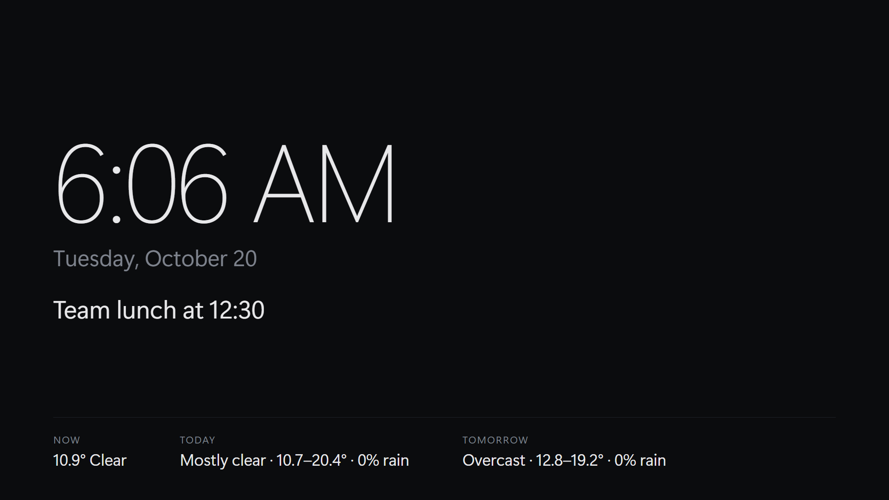

## Why

Windows gives a second monitor two modes: **duplicate** (it shows exactly what one of your screens shows) or **extend** (it's just more desktop). Neither suits a screen other people look at. Team Screen keeps the monitor as its own thing:

- It always shows *something* sensible (a dashboard or any web page).
- You choose exactly what goes on it, and when.
- Sharing copies the pixels off your screen, so anything you're already logged into just appears. Nothing has to sign in on the team screen.

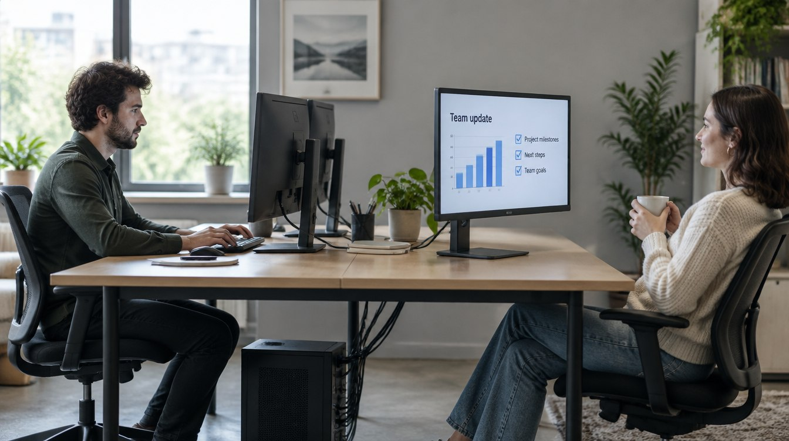

<sub>Illustration (AI-generated).</sub>

## How it works

### 1. Pick what to share

Press `Ctrl` `Alt` `R` (or a spare macro key on your keyboard, see [below](#run-it-from-a-macro-key-stream-deck-or-script)). Your screens dim. Drag a box round what you want to show, like a screenshot tool, or click once to share a whole screen. `Esc` cancels.

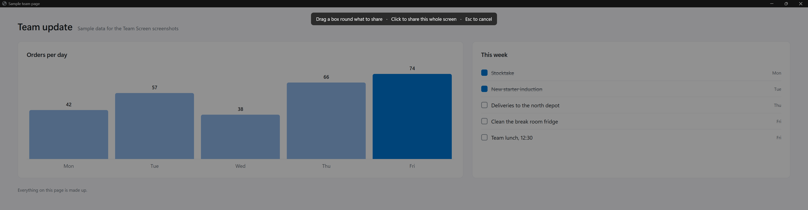

### 2. It's live, and you stay in control

The area goes on the team screen straight away. On *your* screen it gets a red frame and a toolbar. Your team never sees either.

- **Resize:** drag any edge or corner of the red frame.
- **Move:** drag the ✥ handle at the left of the toolbar.
- **Add another:** press `Ctrl` `Alt` `R` again. Both areas show side by side.
- **Stop:** **Stop sharing this area** takes just that one off. `Ctrl` `Alt` `H` stops everything and puts the dashboard back.

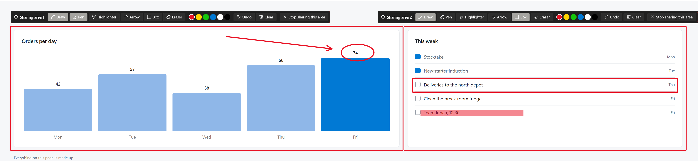

### 3. Draw on it

Click **Draw** (or press `Ctrl` `Alt` `D`) and annotate like the PowerPoint pen: pen, highlighter, arrow, box and eraser in six colours, with **Undo** and **Clear**. Click **Draw** again and your mouse goes back to working your apps. The drawings stay until you clear them.

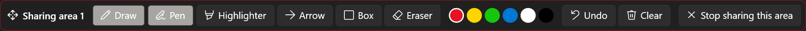

### 4. What your team sees

Each shared area fills its share of the team screen, drawings included, live.

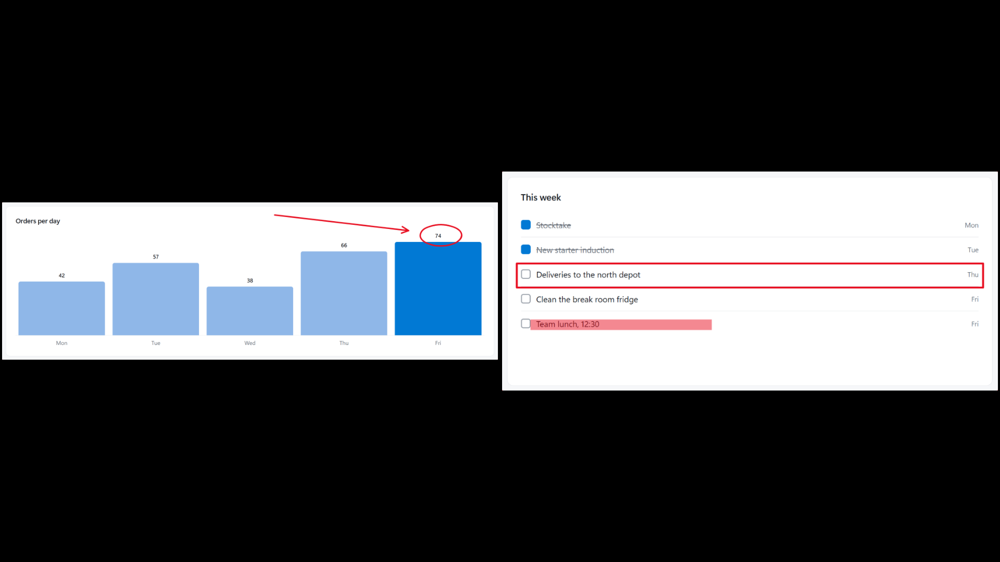

### 5. Keep an eye on it from your desk

Left-click the tray icon for the preview window. It shows exactly what's on the team screen, with one-click **Stop sharing**, **Share another area**, **Draw**, **Freeze** and **Blank**.

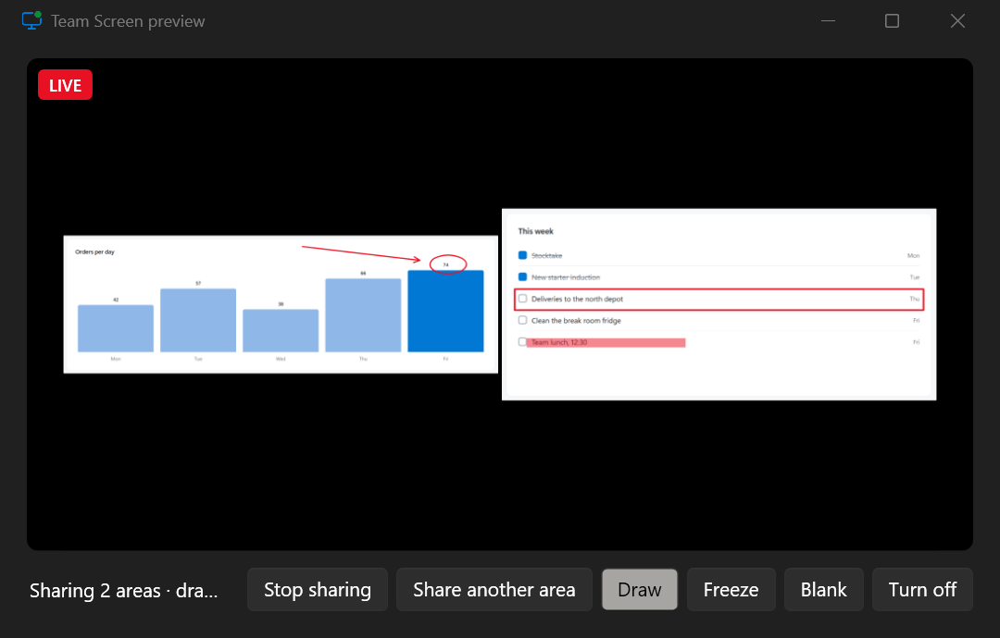

## Features

| Feature | What it does |
|---|---|
| **Dashboard** | Big clock, date, optional message and a 2-day weather forecast. Or use any web page instead (e.g. a Home Assistant dashboard). |
| **Share an area** | Drag a box anywhere on your screens, like a screenshot tool, and it streams live. A click without dragging shares a whole screen. |
| **Several areas at once** | Share another area and the team screen shows them side by side (then in a grid). |
| **Move, resize, stop** | Each shared area gets a red frame you can drag to resize and a toolbar to move it, draw on it or **Stop sharing this area**. Neither appears on the team screen. |
| **Draw on it** | Pen, highlighter, arrow, box and eraser in six colours, with undo and clear, like the PowerPoint pen. Your team sees the drawing. When you stop drawing, clicks go straight through to your apps again. |
| **Share a window** | Streams one window, even when it's covered by other windows. |
| **Show your clipboard** | Snip with Win+Shift+S, then put the picture up. A copied file or link works too. |
| **Drag and drop** | Drop files or links on the preview window to put them up. |
| **Freeze** | Holds whatever is showing while you switch tabs, log in or look something up. |
| **Blank** | Covers the team screen instantly with a message ("Back soon") and mutes it. |
| **Preview window** | A small live view of the team screen on your desk, with quick buttons. |
| **YouTube** | Links open full-screen and autoplay. |
| **Native look** | Windows 11 Fluent styling that follows your light/dark theme and accent colour. Lives in the tray. |

### Preview window

| Live | Blank |
|---|---|
| 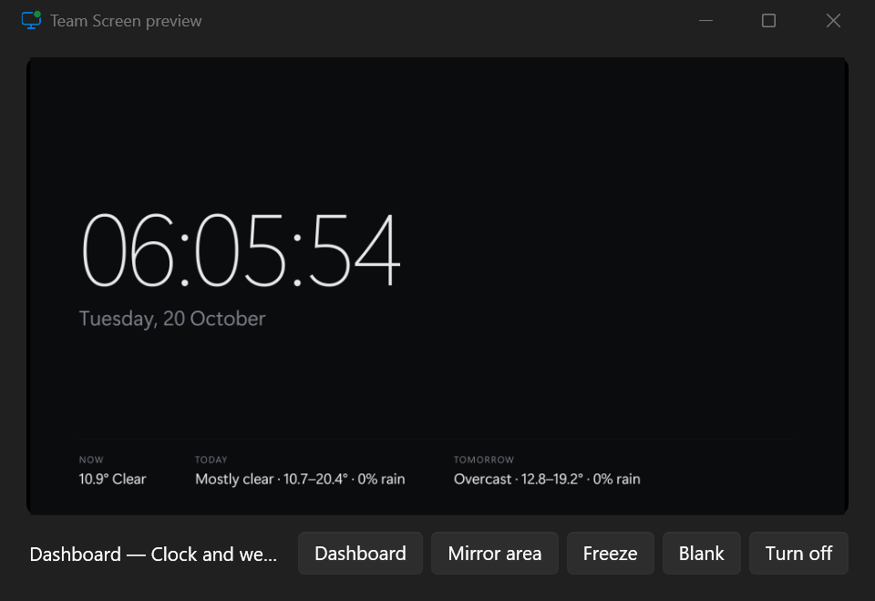 | 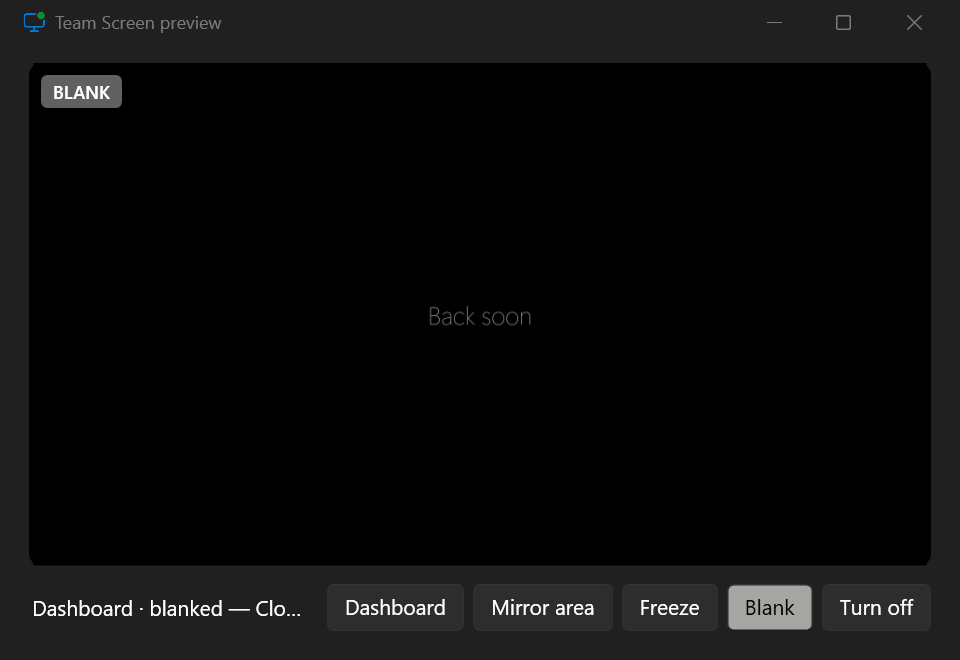 |

### Settings

| General and Dashboard | Sharing and Hotkeys |
|---|---|
| 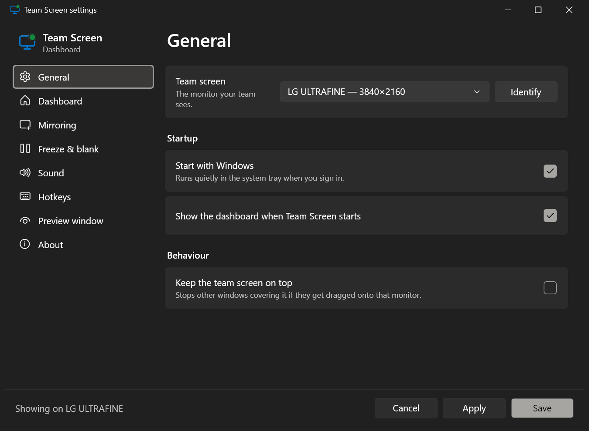 | 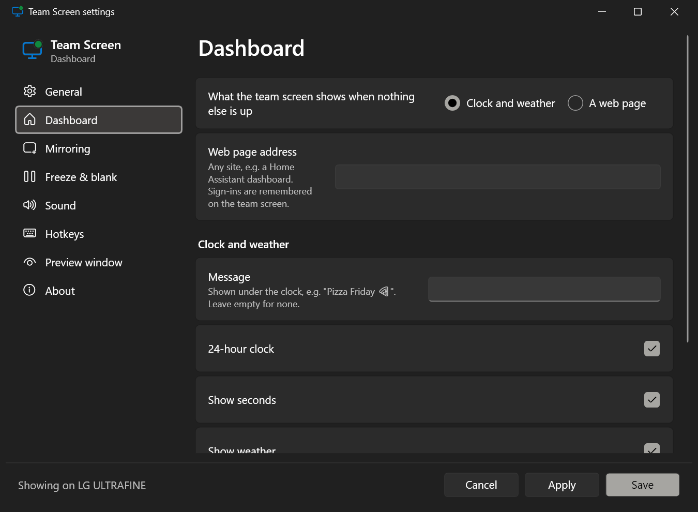 |
| 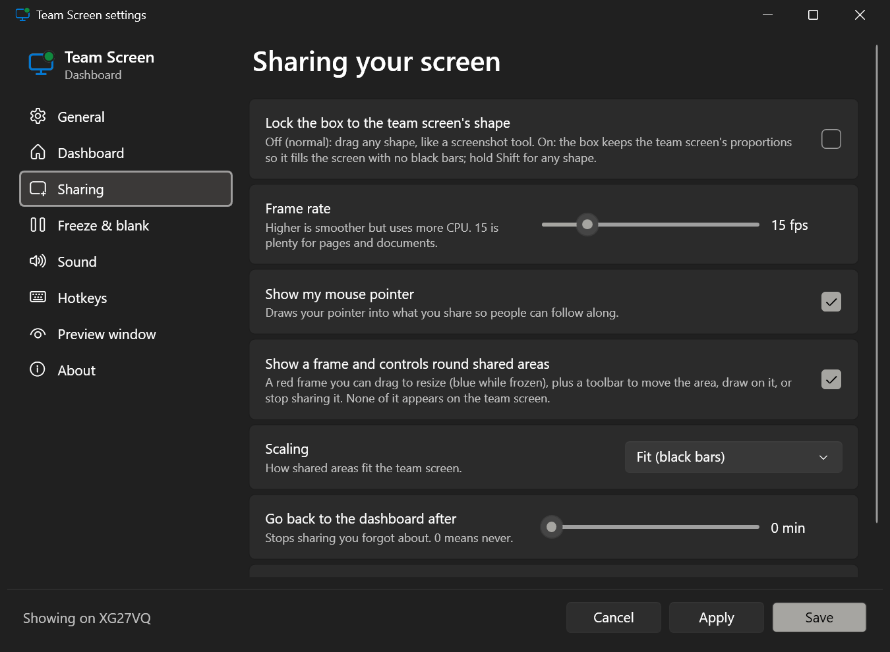 | 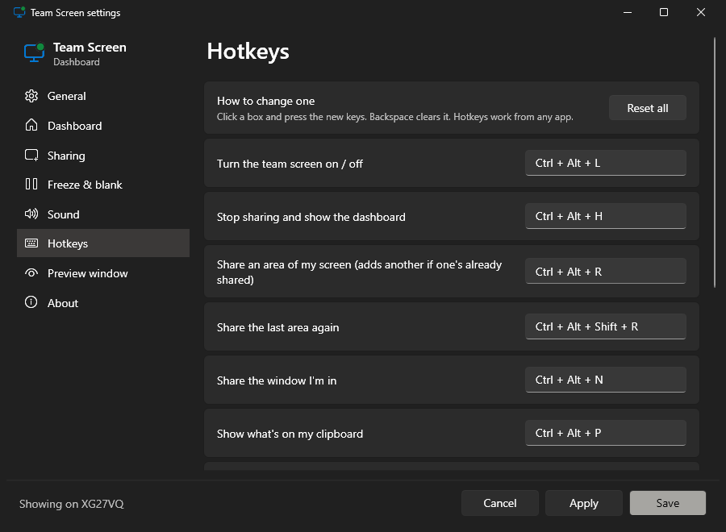 |

Options include: which monitor is the team screen (with **Identify**), start with Windows, keep on top, dashboard message / 24-hour clock / seconds / weather location, sharing frame rate (5–60 fps), show the mouse pointer, frame and controls on/off, lock the box to the team screen's shape, fit/fill/stretch scaling, return to the dashboard after N minutes, blank message, mute while blank, action sounds (any Windows sound, with volume), mute the team screen, and preview window options.

## Hotkeys

All of them can be changed in **Settings → Hotkeys** (click a box, press the new keys).

| Keys | Action |
|---|---|
| `Ctrl` `Alt` `L` | Turn the team screen on/off |
| `Ctrl` `Alt` `H` | Stop sharing and show the dashboard |
| `Ctrl` `Alt` `R` | Share an area (adds another if one's already shared) |
| `Ctrl` `Alt` `Shift` `R` | Share the last area again |
| `Ctrl` `Alt` `N` | Share the window you're in |
| `Ctrl` `Alt` `P` | Show what's on your clipboard |
| `Ctrl` `Alt` `D` | Draw on shared areas on / off |
| `Ctrl` `Alt` `S` | Freeze / unfreeze |
| `Ctrl` `Alt` `B` | Blank / unblank |
| `Ctrl` `Alt` `W` | Show / hide the preview window |

Left-click the tray icon for the preview window. Right-click it for everything else, including a list of open windows to share.

### Run it from a macro key, Stream Deck or script

Team Screen takes commands on the command line and passes them to the copy already running in the tray:

```powershell
TeamScreen.exe --run MirrorArea              # same as Ctrl+Alt+R
TeamScreen.exe --share-area 100,100,1280,720 # share an exact area: x,y,width,height in screen pixels
TeamScreen.exe --run Dashboard               # stop sharing
```

`--run` takes any action name: `ToggleScreen`, `Dashboard`, `MirrorArea`, `MirrorLastArea`, `MirrorActiveWindow`, `ShowClipboard`, `Draw`, `ClearDrawings`, `Freeze`, `Blank`, `TogglePreview`, `OpenSettings`.

For a gaming keyboard's G-keys (Logitech G HUB, Razer Synapse and so on), the simplest option is to set the key to the hotkey itself, e.g. `Ctrl` + `Alt` + `R`.

> **If a hotkey does nothing:** some apps grab keys before Windows can hand them out. These include [Everything](https://www.voidtools.com/) (`Ctrl+Alt+F` by default) and the NVIDIA overlay (`Alt+Z`, `Ctrl+Alt+M`). Team Screen can't detect that kind of conflict, so pick a different combination in Settings.

## Install

1. Download `TeamScreen-win-x64.zip` from the [latest release](../../releases/latest).
2. Unzip it anywhere, e.g. `%LOCALAPPDATA%\Programs\TeamScreen`.
3. Run `TeamScreen.exe`. Settings opens. Pick your team screen and you're done.

It's self-contained, so no .NET install is needed. It uses the WebView2 runtime that ships with Windows 10/11. The app adds itself to startup (Settings → General → *Start with Windows*).

Requirements: Windows 10 version 2004 or later, or Windows 11, x64, and a second monitor set to **Extend** (Win+P → Extend), not Duplicate.

## Build from source

Needs the [.NET 10 SDK](https://dotnet.microsoft.com/download/dotnet/10.0).

```powershell
git clone https://github.com/JakeTheRabbit/team-screen.git
cd team-screen
dotnet run -c Release
```

README screenshots: set `TEAMSCREEN_DOCS_CAPTURE=1` before starting the app so the area frames and toolbars show up in screenshots (normally they're hidden from capture). The sample page is `docs/demo/sample.html`.

Release build (single self-contained exe):

```powershell
dotnet publish -c Release -r win-x64 --self-contained -p:PublishSingleFile=true -p:IncludeNativeLibrariesForSelfExtract=true -o publish
```

## Under the hood

| File | What it does |
|---|---|
| `Controller.cs` | Every action and the team screen's state (dashboard, web page, picture, mirror, freeze, blank). |
| `DisplayWindow.xaml` | Borderless full-screen window on the team monitor: a WebView2 browser plus image layers for live mirror, freeze still and blank. It never takes focus. |
| `CaptureEngine.cs` | Background capture loop: `BitBlt` for areas, `PrintWindow(PW_RENDERFULLCONTENT)` for windows, optional cursor overlay, written into a `WriteableBitmap`. |
| `Overlays.cs` | Area picker (one overlay per monitor, so mixed-DPI setups line up) and Identify. |
| `SharedArea.cs` | One shared area: resize frame and toolbar (both `WDA_EXCLUDEFROMCAPTURE`) and the drawing layer (`InkCanvas`, captured with the area, click-through when not drawing). |
| `HotkeyManager.cs` | System-wide hotkeys via `RegisterHotKey`. |
| `TrayIcon.cs` | Notification-area icon with a status dot and a themed menu. |
| `SettingsWindow.xaml` | Fluent settings UI and the hotkey recorder. |
| `Assets/dashboard.html` | The built-in clock and weather page ([Open-Meteo](https://open-meteo.com/), no API key). |

The app is per-monitor-DPI aware, so every coordinate is a physical pixel. Monitors are identified by their EDID model code, so the right screen stays the team screen across reboots and cable swaps.

Settings live in `%APPDATA%\TeamScreen\settings.json`.

## Privacy

Everything runs locally. Nothing is uploaded. The built-in dashboard makes two requests for weather: [ipapi.co](https://ipapi.co/) for an approximate location (skipped if you set a location in Settings) and [Open-Meteo](https://open-meteo.com/) for the forecast. Turn weather off and it makes none.

## Licence

[MIT](LICENSE)
