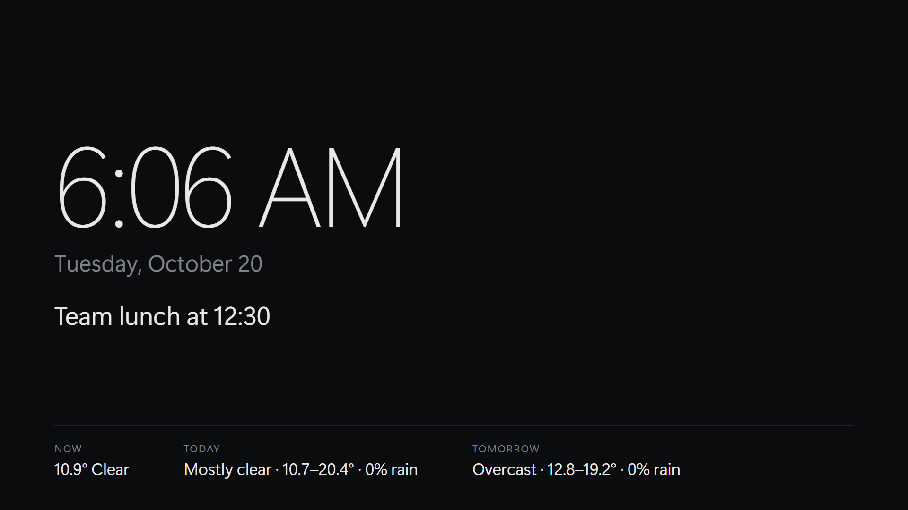
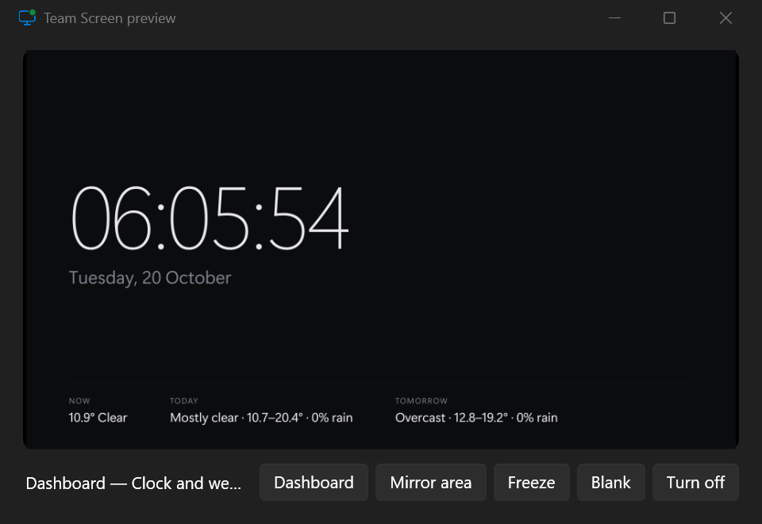
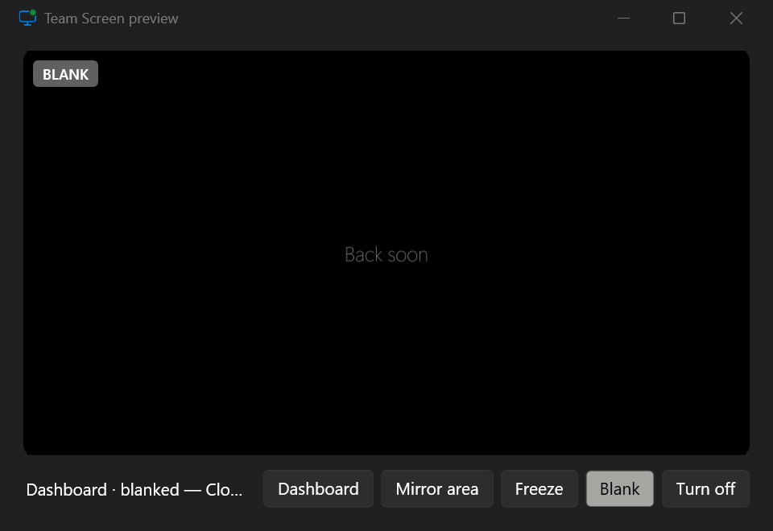
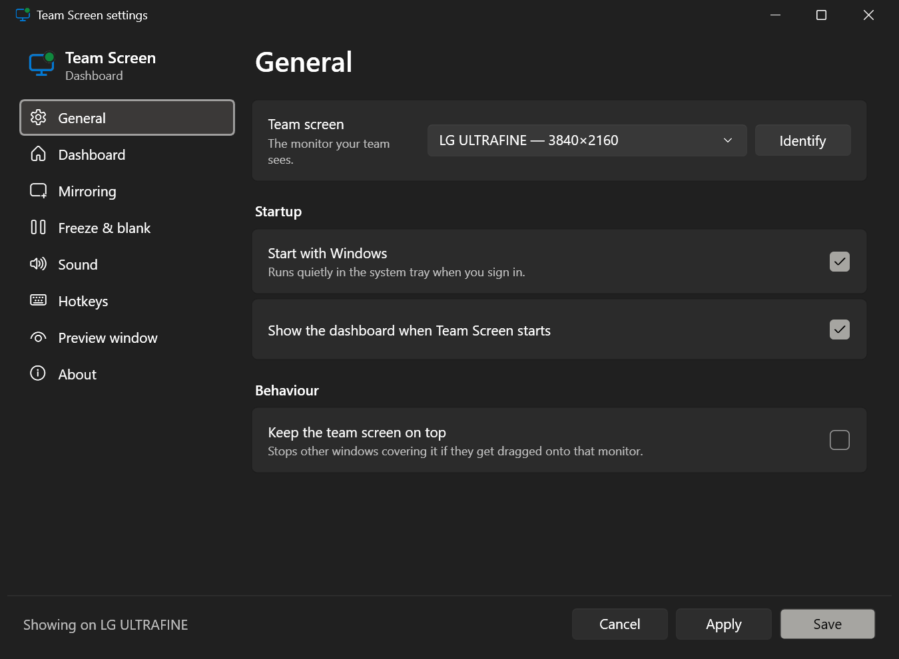
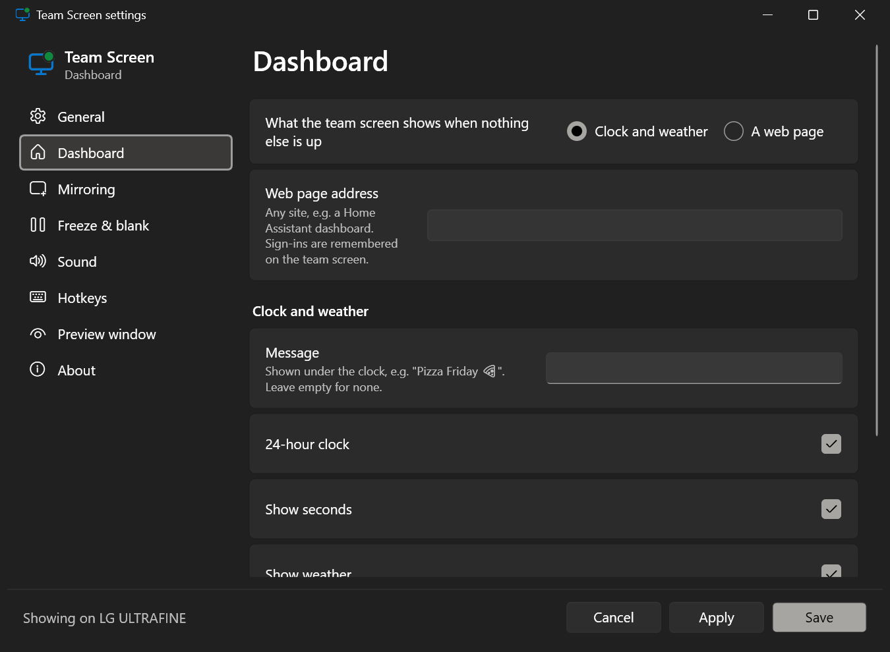
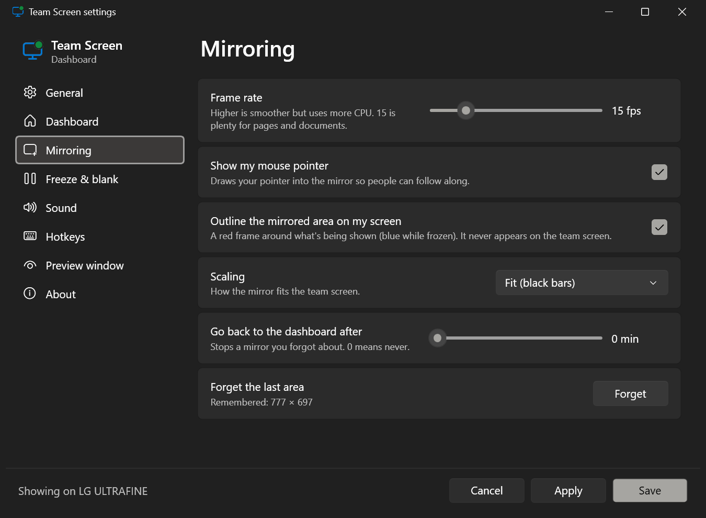
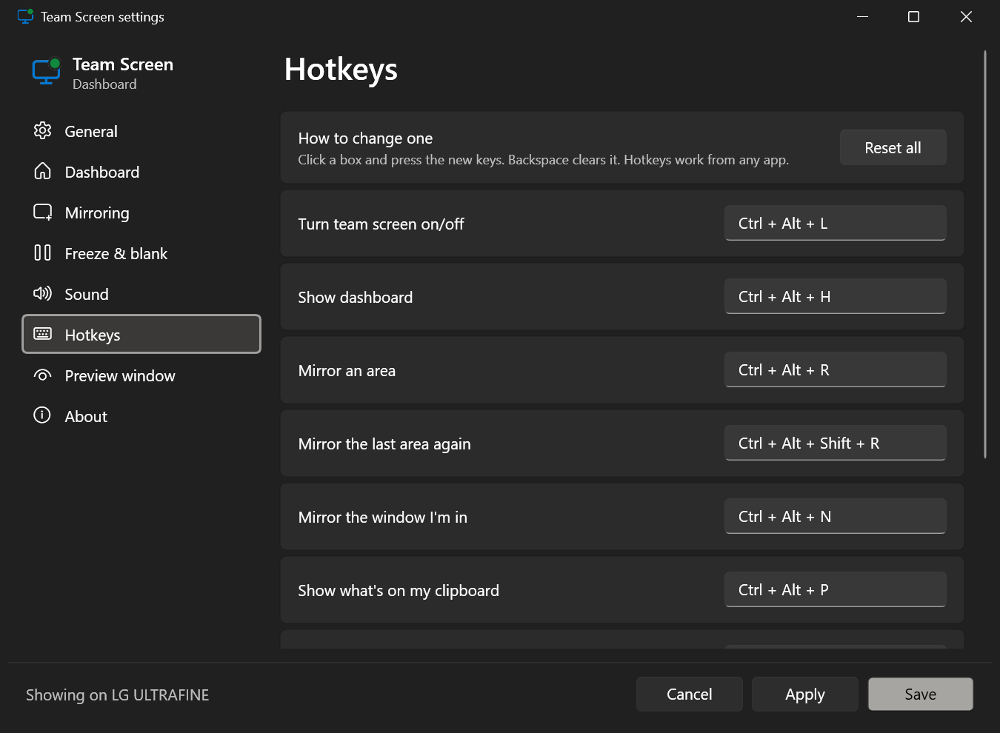

# Team Screen

**Put a dashboard, a picture, a web page or a live piece of your screen on the second monitor your team can see, without touching your own screens.**

Team Screen is a small Windows tray app for the monitor that faces the room: an office wall screen, a reception display, the screen by the lunch table. It shows a clock-and-weather dashboard by default. With one hotkey you can mirror part of your screen to it, freeze it while you carry on working, or blank it if something private comes up.



## Why

Windows gives a second monitor two modes: **duplicate** (it shows exactly what one of your screens shows) or **extend** (it's just more desktop). Neither suits a screen other people look at. Team Screen keeps the monitor as its own thing:

- It always shows *something* sensible (a dashboard or any web page).
- You choose exactly what goes on it, and when.
- Mirroring copies the pixels off your screen, so anything you're already logged into just appears. Nothing has to sign in on the team screen.

## Features

| Feature | What it does |
|---|---|
| **Dashboard** | Big clock, date, optional message and a 2-day weather forecast. Or use any web page instead (e.g. a Home Assistant dashboard). |
| **Mirror an area** | Drag a box anywhere on your screens and it streams live. A click without dragging takes a whole screen. A red outline shows what's live; it's excluded from capture, so it never appears on the team screen. |
| **Mirror a window** | Streams one window, even when it's covered by other windows. |
| **Show your clipboard** | Snip with Win+Shift+S, then put the picture up. A copied file or link works too. |
| **Drag and drop** | Drop files or links on the preview window to put them up. |
| **Freeze** | Holds whatever is showing while you switch tabs, log in or look something up. |
| **Blank** | Covers the team screen instantly with a message ("Back soon") and mutes it. |
| **Preview window** | A small live view of the team screen on your desk, with quick buttons. |
| **YouTube** | Links open full-screen and autoplay. |
| **Native look** | Windows 11 Fluent styling that follows your light/dark theme and accent colour. Lives in the tray. |

### Preview window

| Live | Blank |
|---|---|
|  |  |

### Settings

| General and Dashboard | Mirroring and Hotkeys |
|---|---|
|  |  |
|  |  |

Options include: which monitor is the team screen (with **Identify**), start with Windows, keep on top, dashboard message / 24-hour clock / seconds / weather location, mirror frame rate (5–60 fps), show the mouse pointer, outline on/off, fit/fill/stretch scaling, return to the dashboard after N minutes, blank message, mute while blank, action sounds (any Windows sound, with volume), mute the team screen, and preview window options.

## Hotkeys

All of them can be changed in **Settings → Hotkeys** (click a box, press the new keys).

| Keys | Action |
|---|---|
| `Ctrl` `Alt` `L` | Turn the team screen on/off |
| `Ctrl` `Alt` `H` | Show the dashboard |
| `Ctrl` `Alt` `R` | Mirror an area (drag a box) |
| `Ctrl` `Alt` `Shift` `R` | Mirror the last area again |
| `Ctrl` `Alt` `N` | Mirror the window you're in |
| `Ctrl` `Alt` `P` | Show what's on your clipboard |
| `Ctrl` `Alt` `S` | Freeze / unfreeze |
| `Ctrl` `Alt` `B` | Blank / unblank |
| `Ctrl` `Alt` `W` | Show / hide the preview window |

Left-click the tray icon for the preview window. Right-click it for everything else, including a list of open windows to mirror.

> **If a hotkey does nothing:** some apps grab keys before Windows can hand them out. These include [Everything](https://www.voidtools.com/) (`Ctrl+Alt+F` by default) and the NVIDIA overlay (`Alt+Z`, `Ctrl+Alt+M`). Team Screen can't detect that kind of conflict, so pick a different combination in Settings.

## Install

1. Download `TeamScreen-win-x64.zip` from the [latest release](../../releases/latest).
2. Unzip it anywhere, e.g. `%LOCALAPPDATA%\Programs\TeamScreen`.
3. Run `TeamScreen.exe`. Settings opens. Pick your team screen and you're done.

It's self-contained, so no .NET install is needed. It uses the WebView2 runtime that ships with Windows 10/11. The app adds itself to startup (Settings → General → *Start with Windows*).

Requirements: Windows 10 version 2004 or later, or Windows 11, x64, and a second monitor set to **Extend** (Win+P → Extend), not Duplicate.

## Build from source

Needs the [.NET 10 SDK](https://dotnet.microsoft.com/download/dotnet/10.0).

```powershell
git clone https://github.com/JakeTheRabbit/team-screen.git
cd team-screen
dotnet run -c Release
```

Release build (single self-contained exe):

```powershell
dotnet publish -c Release -r win-x64 --self-contained -p:PublishSingleFile=true -p:IncludeNativeLibrariesForSelfExtract=true -o publish
```

## How it works

| File | What it does |
|---|---|
| `Controller.cs` | Every action and the team screen's state (dashboard, web page, picture, mirror, freeze, blank). |
| `DisplayWindow.xaml` | Borderless full-screen window on the team monitor: a WebView2 browser plus image layers for live mirror, freeze still and blank. It never takes focus. |
| `CaptureEngine.cs` | Background capture loop: `BitBlt` for areas, `PrintWindow(PW_RENDERFULLCONTENT)` for windows, optional cursor overlay, written into a `WriteableBitmap`. |
| `Overlays.cs` | Area picker (one overlay per monitor, so mixed-DPI setups line up), the click-through outline (`WDA_EXCLUDEFROMCAPTURE`), and Identify. |
| `HotkeyManager.cs` | System-wide hotkeys via `RegisterHotKey`. |
| `TrayIcon.cs` | Notification-area icon with a status dot and a themed menu. |
| `SettingsWindow.xaml` | Fluent settings UI and the hotkey recorder. |
| `Assets/dashboard.html` | The built-in clock and weather page ([Open-Meteo](https://open-meteo.com/), no API key). |

The app is per-monitor-DPI aware, so every coordinate is a physical pixel. Monitors are identified by their EDID model code, so the right screen stays the team screen across reboots and cable swaps.

Settings live in `%APPDATA%\TeamScreen\settings.json`.

## Privacy

Everything runs locally. Nothing is uploaded. The built-in dashboard makes two requests for weather: [ipapi.co](https://ipapi.co/) for an approximate location (skipped if you set a location in Settings) and [Open-Meteo](https://open-meteo.com/) for the forecast. Turn weather off and it makes none.

## Licence

[MIT](LICENSE)
